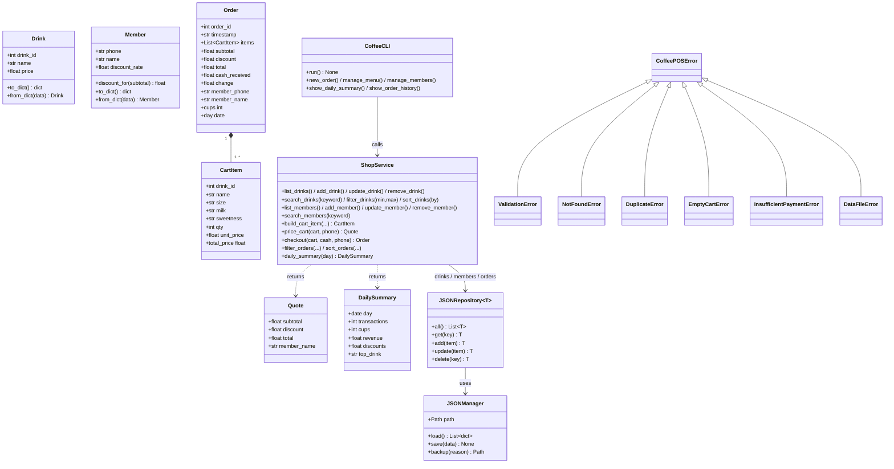

# PLAN.md — Group15 Express Coffee (Smart POS Coffee Terminal)

> รายวิชา CP352301 Script Programming · Final Project · อัปเดตสำหรับ **Sprint 2–3**
> สมาชิก: รพีพรรณ ศรีบุญเรือง · สุกิจตรา โคแสงรักษา · วิยดา มูลกัน · สุภกร กงชา (บทบาทหมุนเวียนตามตารางใน Sprint 2–3)

## 1. ปัญหาและคุณค่า

ร้านกาแฟขนาดเล็กต้องรับออเดอร์ที่ปรับแต่งได้ (ขนาด, นม, ความหวาน), คิดส่วนลดสมาชิก, ทอนเงิน
และสรุปยอดขาย โดยไม่ต้องใช้เครื่อง POS ราคาแพง ระบบนี้เป็น POS แบบ Terminal ที่
**เก็บข้อมูลถาวร** (ปิดโปรแกรมแล้วยอดขายไม่หาย), **จัดการเมนูและสมาชิกได้เอง** และ
**ไม่พังเมื่อกรอกข้อมูลผิดหรือไฟล์เสีย**

## 2. สถาปัตยกรรม 3 เลเยอร์ (Separation of Concerns)

```
┌─────────────────────────────────────────────────────────────┐
│ Presentation Layer   coffee_pos/ui/cli.py   (CoffeeCLI)     │  เมนู, prompt, พิมพ์ใบเสร็จ
│  - ไม่มีสูตรคำนวณ/ไฟล์ เรียก ShopService เท่านั้น             │
├─────────────────────────────────────────────────────────────┤
│ Business Logic Layer   coffee_pos/services/shop_service.py  │  CRUD, ค้นหา/กรอง/เรียง,
│  - ไม่มี print()/input()  ทดสอบได้โดยไม่ต้องมี Terminal       │  คิดราคา, checkout, สรุปยอด
│  coffee_pos/models/*  (Domain Models + validation)          │
├─────────────────────────────────────────────────────────────┤
│ Data Access Layer   coffee_pos/data_access/                 │  File I/O, กู้ไฟล์เสีย,
│  JSONManager (ไฟล์)  ·  JSONRepository (รายการใน RAM)        │  เขียนไฟล์ทุกครั้งที่ข้อมูลเปลี่ยน
└─────────────────────────────────────────────────────────────┘
```

### โครงสร้างโฟลเดอร์

```
coffee-pos/
├── main.py                      # จุดเริ่มโปรแกรม
├── coffee_pos/
│   ├── exceptions.py            # Custom Exceptions
│   ├── models/                  # Drink, Member, CartItem, Order, Quote, DailySummary
│   ├── data_access/             # JSONManager, JSONRepository
│   ├── services/shop_service.py # ShopService + build_service()
│   └── ui/cli.py                # CoffeeCLI
├── tests/                       # unittest (56 tests)
├── data/                        # menu.json, members.json, orders.json (สร้างอัตโนมัติ)
├── docs/SPRINT2-3_REPORT.md     # Test Log + Wow!/Whoops!
└── PLAN.md
```

## 3. UML Class Diagram



## 4. Data Schema (JSON)

**data/menu.json**
```json
[{"drink_id": 1, "name": "Espresso", "price": 55.0}]
```
**data/members.json**
```json
[{"phone": "0812345678", "name": "Somchai", "discount_rate": 0.1}]
```
**data/orders.json**
```json
[{
  "order_id": 1, "timestamp": "2026-10-12 09:02:51",
  "items": [{"drink_id": 2, "name": "Americano", "size": "L", "milk": "Almond Milk",
             "sweetness": "50%", "qty": 1, "unit_price": 95.0, "total_price": 95.0}],
  "subtotal": 95.0, "discount": 0.0, "total": 95.0,
  "cash_received": 100.0, "change": 5.0,
  "member_phone": null, "member_name": "Guest"
}]
```
ขนาด/นม/ความหวาน (`SIZE_OPTIONS`, `MILK_OPTIONS`, `SWEETNESS_LEVELS`) เป็นค่าคงที่ใน
`models/options.py` ไม่ได้เก็บในไฟล์

## 5. Definition of Done (DoD)

**ฟังก์ชันหลัก**
- [x] CRUD เมนู (เพิ่ม/แก้/ลบ/ดู) และ CRUD สมาชิก — ข้อมูลอยู่ในไฟล์หลังปิดโปรแกรม
- [x] ค้นหาเมนูตามชื่อ (ไม่สนตัวพิมพ์), กรองตามช่วงราคา, เรียงตามชื่อ/ราคา (น้อย→มาก, มาก→น้อย)
- [x] ประวัติออเดอร์: กรองตามวันที่/ช่วงยอด/สมาชิก และเรียงตามเวลา/ยอด
- [x] สรุปยอดขายรายวัน (จำนวนรายการ, แก้ว, ส่วนลด, รายได้, เมนูขายดี) เลือกวันได้
- [x] Flow สั่งซื้อเดิมจาก Sprint 1 ใช้งานได้ครบ (ขนาด, นม, ความหวาน, สมาชิก 10%, ใบเสร็จ)

**พฤติกรรมเมื่อเกิดข้อผิดพลาด**
- [x] ไฟล์ข้อมูลหาย → สร้างไฟล์เริ่มต้นเอง ไม่พัง
- [x] JSON เสีย/ชนิดผิด → สำรองเป็น `*.bak` แล้วกู้ค่าเริ่มต้น พร้อมแจ้งผู้ใช้
- [x] ระเบียนในไฟล์ไม่ถูกต้อง → ข้ามเฉพาะระเบียนนั้น + สำรองไฟล์ + แจ้งจำนวนที่ข้าม
- [x] เขียนไฟล์ไม่ได้ → แจ้ง `DataFileError`, ข้อมูลใน RAM ย้อนกลับ (RAM = ไฟล์เสมอ)
- [x] ลบ/แก้รายการที่ไม่มี → `NotFoundError` ที่จัดการแล้ว ไม่ทำให้โปรแกรมพัง
- [x] ป้อนตัวอักษร/ค่าติดลบ/ค่าว่าง/`nan`/`inf`/นอกช่วง → แจ้งเตือนและถามใหม่
- [x] Ctrl+C / Ctrl+D ระหว่างทำงาน → ออกอย่างสุภาพ ไม่มี traceback
- [x] พิมพ์ `cancel` ที่ prompt ใดก็ได้ → ยกเลิกรายการและกลับเมนู

**End-to-End DoD (Sprint 3):** เมนู CLI ทุกข้อเรียก `ShopService` โดยตรง และ
`python -m unittest discover` ผ่านทั้งหมด (56/56)

## 6. การจัดการ State และ Data Consistency (Sprint 3)

- `JSONRepository` เก็บข้อมูลใน RAM แบบ `dict` และ **เขียนไฟล์ทุกครั้งที่เปลี่ยน** (write-through)
- ถ้าเขียนไฟล์ล้มเหลว จะ **rollback** การเปลี่ยนใน RAM ทันที → RAM กับไฟล์ไม่เคยไม่ตรงกัน
- เขียนไฟล์แบบ atomic (เขียนไฟล์ชั่วคราวแล้ว `os.replace`) → ไม่เกิดไฟล์ครึ่งๆ กลางๆ ถ้าโปรแกรมถูกปิดกลางคัน
- ตะกร้า (cart) เป็นรายการใน UI ตลอดการสั่ง และถูกบันทึกลง `orders.json` ครั้งเดียวตอนจ่ายเงินสำเร็จ

## 7. การเปรียบเทียบทางเลือกด้านการออกแบบ

| เรื่อง | ที่เลือก | ทางเลือกอื่น | เหตุผล |
|---|---|---|---|
| ที่เก็บข้อมูล | JSON | CSV / SQLite | ออเดอร์มีรายการซ้อนหลายบรรทัด (nested) JSON เก็บตรงๆ ได้ CSV ต้องแยกตาราง; SQLite เหมาะกว่าถ้าข้อมูลหลักหมื่นแถวขึ้นไป แต่เกินความจำเป็นของร้านเดียว |
| จังหวะบันทึก | เขียนทันทีทุกการเปลี่ยน | บันทึกตอนออกโปรแกรม | ไฟดับ/โปรแกรมค้างข้อมูลไม่หาย; แลกกับเขียนไฟล์บ่อยขึ้น (วัดแล้ว 300 รายการ ≈ 0.26 วินาที) |
| การเรียงลำดับ | `sorted()` (Timsort) ด้วย key | เขียน bubble/merge sort เอง | เสถียร, O(n log n), วัดจริง 1,006 รายการเรียง 0.22 ms |
| Domain model | `@dataclass` + validate ใน `__post_init__` | dict ธรรมดา | ข้อมูลไม่ถูกต้องเข้าระบบไม่ได้ตั้งแต่ต้นทาง |
| เงิน | `float` ปัดทศนิยม 2 ตำแหน่ง | `Decimal` | ราคาเป็นจำนวนเต็มบาท + ส่วนลด 10% ปัดทุกขั้น; ถ้าต้องรองรับสตางค์/ภาษีจริงควรย้ายไป `Decimal` |
| Design Pattern | Repository, Service Layer, Dependency Injection (`ShopService` รับ repo/clock, `CoffeeCLI` รับ input/output) | เรียกไฟล์ตรงจาก UI | ทดสอบได้ด้วย input จำลองและนาฬิกาปลอม |

## 8. ประวัติ Refactor (Sprint 1 → Sprint 2–3)

| Sprint 1 (ไฟล์เดียว, procedural) | Sprint 2–3 | เหตุผล |
|---|---|---|
| `MENU`, `MEMBERS` เป็น dict ฮาร์ดโค้ด | `Drink`, `Member` + `menu.json`, `members.json` | แก้ไขเมนู/สมาชิกได้โดยไม่แก้โค้ด |
| `sales_history` เป็น list ใน RAM (ปิดโปรแกรมแล้วหาย) | `Order` + `orders.json` | ข้อมูลยอดขายคงอยู่ |
| `get_customization()` / `take_order()` / `checkout()` ปนทั้ง input, คิดเงิน, พิมพ์ | UI → `ShopService.build_cart_item()/price_cart()/checkout()` | แยก Presentation / Business Logic |
| qty ผิด → `continue` ทิ้งตัวเลือกขนาด/นมที่เลือกไว้ | ถามเฉพาะ qty ใหม่ | แก้บั๊ก UX |
| `float(input())` รับ `inf` ได้ (เงินทอน = inf) | `require_number()` ปฏิเสธ `nan`/`inf` | แก้บั๊ก validation |
| Exit เป็นเมนู 3 | เมนู 1–2 คงเดิม, เพิ่ม 3–5, Exit = `0` | เพิ่มฟีเจอร์ Sprint 2 |

## 9. แนวทางต่อยอด (สำหรับ Final Sprint)

GitHub Actions (flake8 + `unittest`), เปลี่ยน storage เป็น SQLite โดยเขียน repository ตัวใหม่
โดยไม่แตะ `ShopService`, ฟีเจอร์ AI/Automation เช่นสรุปยอดขายอัตโนมัติหรือแนะนำเมนูขายดี
